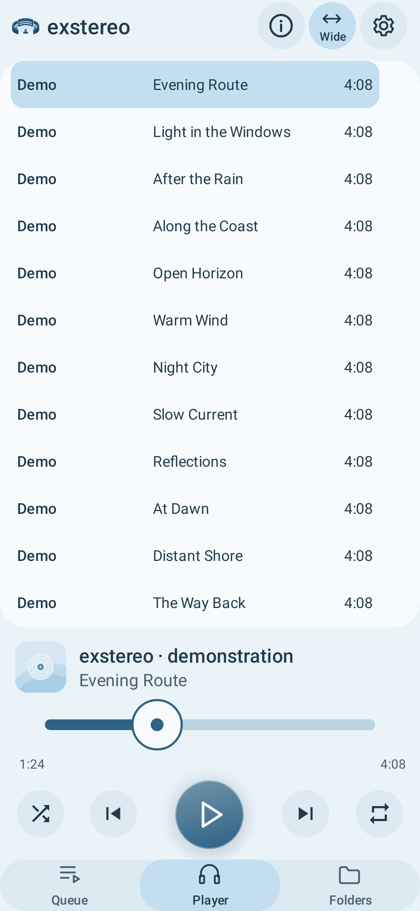
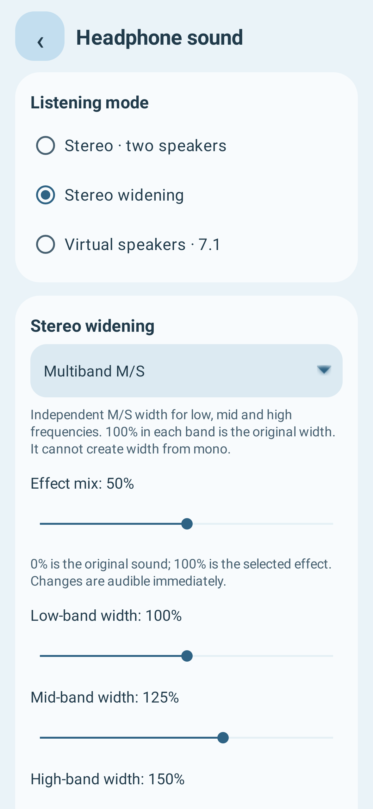
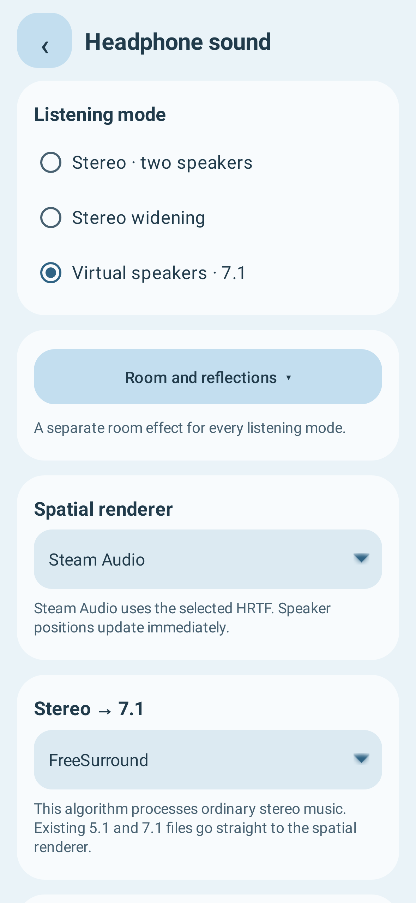

# exstereo

[Русский](README.md) · English

Four applications for headphone listening: an Android music player, a desktop stereo/7.1 upmixer, and two experimental tools that estimate an HRTF profile from ear photographs.

Original applications and modifications by **DysseuX / DysseuX Group**. The player is based on Fossify Music Player. Third-party authors are listed in [AUTHORS.md](AUTHORS.md).

| Application | Purpose | Platform |
| --- | --- | --- |
| [exstereo](android-player) | Local music playback, stereo widening, virtual speakers and 7.1, 30-band EQ | Android 8.0+, arm64-v8a and x86_64 |
| [Upmixer](kubuntu-upmixer) | Demucs stem separation, stem mixing, stereo or 7.1 Opus export | Kubuntu / Linux |
| [Photo HRTF](android-hrtf) | Ear photos and head dimensions → experimental SOFA profile | Android 8.0+, arm64-v8a |
| [Desktop Photo HRTF](kubuntu-hrtf) | Photo preparation and HRTF estimation on a PC | Kubuntu / Linux |

Download APKs and matching source archives from the [exstereo 1.8.1-i18n1 / 32](https://github.com/DysseuX/exstereo/releases/tag/player-v32) and [Photo HRTF 0.2.0 / 2](https://github.com/DysseuX/exstereo/releases/tag/hrtf-v0.2.0) releases. The APK files are `exstereo-v32.apk` and `hrtf-photo-v2.apk`. These are separate applications.

Both Android applications choose their interface language automatically from the first language in the system list: Russian (`ru`) selects Russian; any other first language selects English. There is no manual language switch.

## Android player

The main focus is stereo widening and virtual surround in ordinary headphones.

- Eleven widening algorithms, including M/S, multiband M/S, Haas, allpass/velvet noise, PAE/PAD, Side synthesis and MicroPitch.
- Stereo upmix through FreeSurround, PAE/PAD or FFmpeg surround. Existing 5.1/7.1 audio goes directly to the spatial renderer.
- Steam Audio, OpenAL Soft and FFmpeg sofalizer renderers; adjustable virtual speakers and room reflections.
- Steam Audio, MIT KEMAR and SADIE H3/H10 HRTFs, plus SOFA import. OpenAL Soft uses its own built-in HRTF; imported SOFA is used by the other two renderers.
- A 30-band equalizer, 25 Hz–20 kHz, ±12 dB, and a full library with tracks, artists, albums, genres, folders and playlists.
- Offline playback.

These Android versions add English/Russian localization while retaining the player’s sound features, equalizer and library, and the HRTF generation pipeline.

Headphone output is two-channel PCM16. Virtual 7.1 does not output eight physical channels. Inputs above 48 kHz are resampled to 48 kHz before DSP; 44.1 and 48 kHz are preserved. Dolby Atmos object rendering, MPEG-H and head tracking are not implemented. The player does not run Demucs or ITSADIVE.

## Desktop upmixer and Photo HRTF

Upmixer supports Demucs `htdemucs`, `htdemucs_ft` and `htdemucs_6s`; the default is `htdemucs_ft`. Adjust stem width, pan and level, then export stereo or eight-channel Ogg Opus. Existing stems can be reused. Processing is local once dependencies and model weights are downloaded. CPU is the default; CUDA must be selected explicitly.

Photo HRTF uses ITSADIVE and VIKING reference data. Mark the ear canal and a ruler in each photo, enter head dimensions, then generate a SOFA file for the player. Android runs two inference-only ONNX models locally, without Python or training. Its photo guide supports moving and scaling the image; the ruler defines the physical scale, and the guide itself is not passed to the model.

This is an experimental estimate, not an acoustic measurement. A personal profile is not guaranteed to sound better than a generic HRTF.

## Interface

These images show real Android Views rendered in a test environment with demonstration data. They are not screenshots from a physical phone.

<p>
  
  
  
</p>

More images: [player](docs/screenshots/player) · [Photo HRTF](docs/screenshots/hrtf).

## Running and building

See [BUILDING.md](BUILDING.md) for setup and build requirements. Linux applications use their own portable setup and launch scripts. HRTF has a separate Python environment; it must not replace the upmixer’s Torch/torchaudio installation.

```bash
bash kubuntu-upmixer/setup.sh
bash kubuntu-upmixer/launch.sh
```

```bash
bash kubuntu-hrtf/setup.sh
bash kubuntu-hrtf/launch.sh
```

Run `bash build-limited.sh :app:assembleFossDebug` inside `android-player`, or `bash build-limited.sh :app:assembleDebug` inside `android-hrtf`. HRTF models and the SOFA template are included; ordinary Android builds do not need to regenerate them.

Build and compute scripts share a resource limiter: 210% total CPU on three available cores, 3 GiB RAM, no swap and one heavy operation at a time.

Automated validation results apply to a specific version; check the corresponding release notes. The current Android applications **have not been validated on a physical phone**. The minimum practical CPU and RAM requirements are not established. Complex effects can cause audio dropouts on slower devices; Demucs on CPU can take longer than the recording itself. Report reproducible problems in **Issues**, with the application version, OS, selected mode and steps.

## Licenses

The player is **GPLv3**; Upmixer is **GPLv2 or later**. GPL permits commercial use and sale under its terms. Original code in both HRTF applications is **PolyForm Noncommercial 1.0.0**: source-available with noncommercial terms, not OSI open source.

Third-party components retain their licenses. SADIE H3 has noncommercial data terms; SADIE H10 is Apache-2.0, VIKING is CC BY 4.0, and ITSADIVE is MIT. See [LICENSING.md](LICENSING.md) and the component notices for the full scope and attribution.
