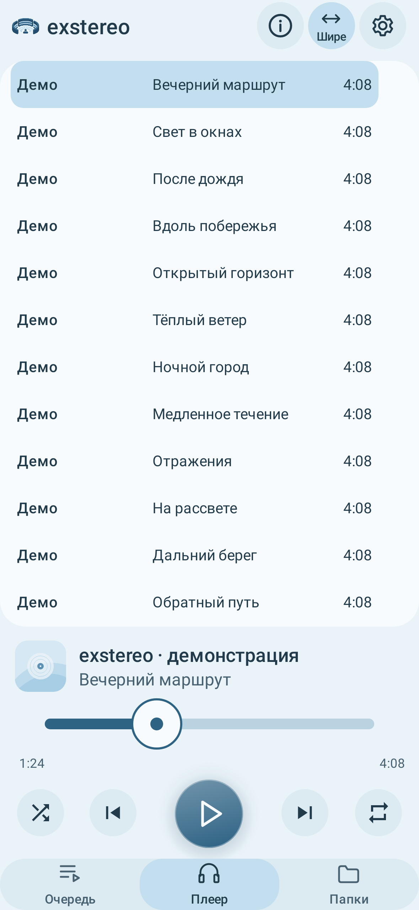
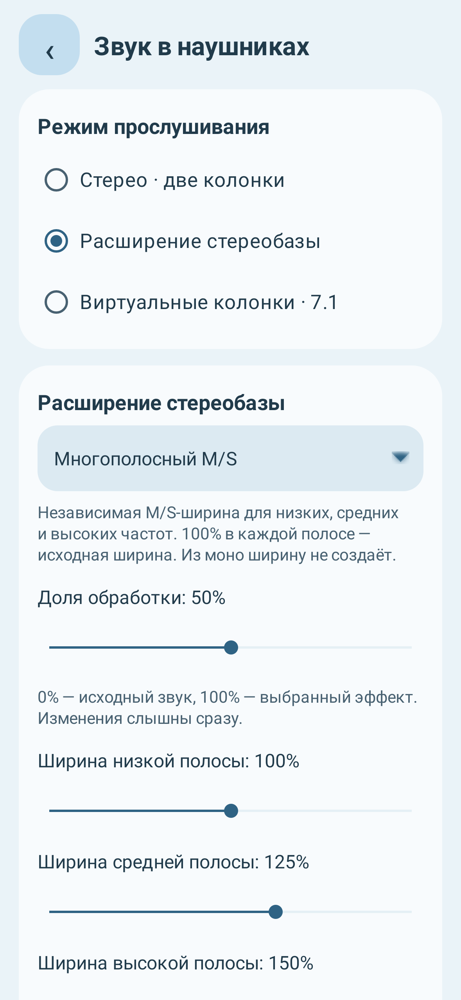
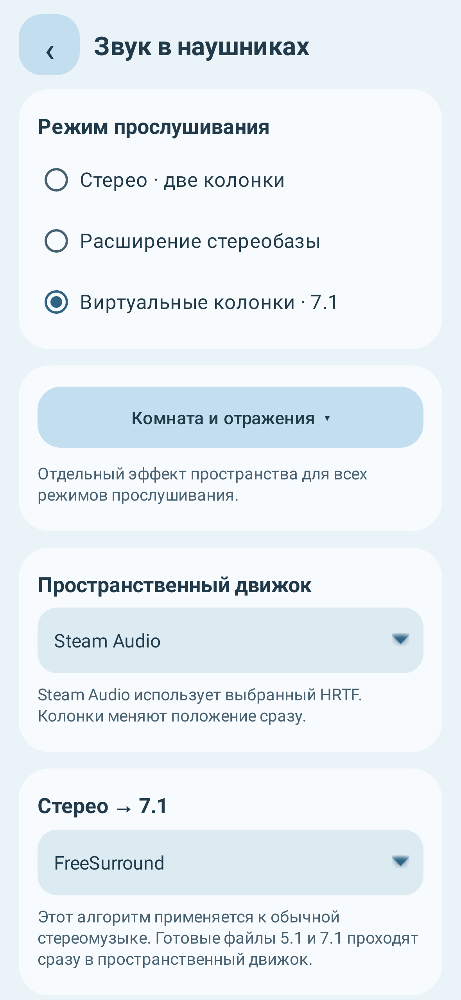
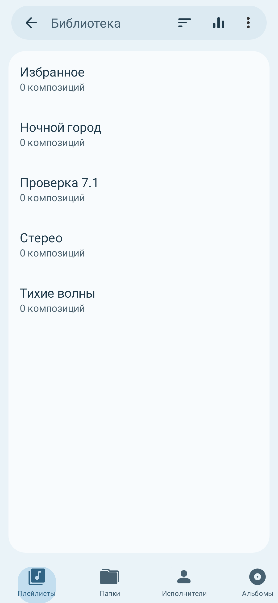
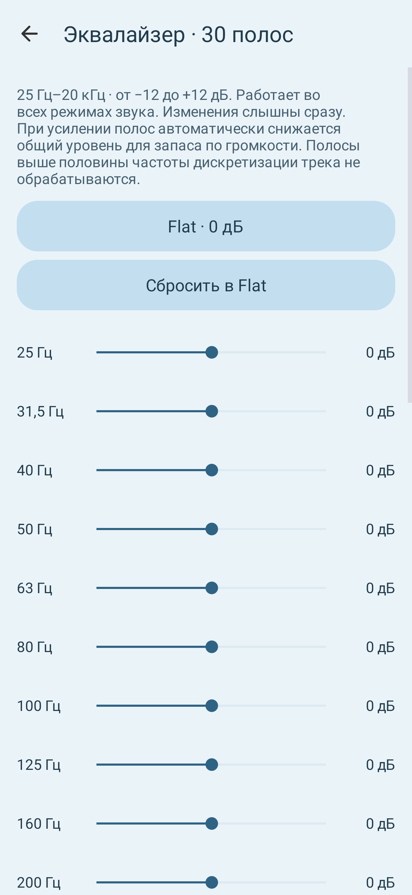
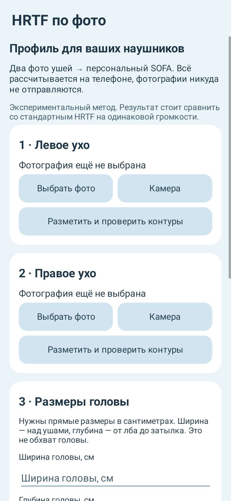

# exstereo

Русский · [English](README.en.md)

Четыре программы для музыки в наушниках: Android-плеер, подготовка стерео и 7.1 на ПК и два приложения для расчёта HRTF по фотографиям ушей.

Автор собственных приложений и изменений — **DysseuX / DysseuX Group**. Основа плеера — Fossify Music Player. Авторы библиотек, моделей и данных перечислены в [AUTHORS.md](AUTHORS.md).

| Программа | Что делает | Система |
| --- | --- | --- |
| [exstereo](android-player) | Воспроизведение музыки, расширение стерео, виртуальные колонки и 7.1, 30-полосный EQ | Android 8.0+, arm64-v8a и x86_64 |
| [Upmixer](kubuntu-upmixer) | Разделение музыки через Demucs, настройка стемов, экспорт стерео или Opus 7.1 | Kubuntu / Linux |
| [HRTF по фото](android-hrtf) | Фото ушей и размеры головы → экспериментальный профиль SOFA | Android 8.0+, arm64-v8a |
| [HRTF по фото для ПК](kubuntu-hrtf) | Тот же подход с подготовкой контуров и расчётом профиля на ПК | Kubuntu / Linux |

Скачайте APK и соответствующие исходники в выпусках [exstereo v32 / 1.8.1-i18n1](https://github.com/DysseuX/exstereo/releases/tag/player-v32) и [HRTF по фото v2 / 0.2.0](https://github.com/DysseuX/exstereo/releases/tag/hrtf-v0.2.0). Файлы — `exstereo-v32.apk` и `hrtf-photo-v2.apk`. Плеер и HRTF устанавливаются как отдельные приложения. Программы для ПК запускаются из исходников.

Оба Android-приложения автоматически выбирают язык по первому языку в системном списке: русский (`ru`) → русский интерфейс, любой другой → английский. Ручного переключателя языка нет. В этих версиях добавлена локализация; звуковые функции, 30-полосный EQ, библиотека и расчёт HRTF сохранены.

## Плеер

Основной упор — на расширение стерео и виртуальные колонки в обычных наушниках.

- 11 алгоритмов расширения: M/S, многополосный M/S, FFmpeg extrastereo/stereowiden/Haas, StereoWidener allpass/velvet noise, PAE/PAD, синтез Side, shuffler и MicroPitch.
- Upmix стерео через FreeSurround, PAE/PAD (Wiener) или FFmpeg surround. Готовые 5.1/7.1 проходят в пространственный рендерер без повторного upmix.
- Рендереры Steam Audio, OpenAL Soft и FFmpeg sofalizer. Можно менять положение виртуальных колонок и отражения комнаты. Для стерео есть отдельная сцена L/R.
- HRTF Steam Audio, MIT KEMAR, SADIE H3/H10 и импорт SOFA. OpenAL Soft использует собственный встроенный HRTF; импортированный SOFA работает с другими двумя рендерерами.
- Эквалайзер на 30 полос, 25 Гц–20 кГц, ±12 дБ. Полная библиотека: треки, исполнители, альбомы, жанры, папки и плейлисты.
- Локальное воспроизведение без интернета. Нейросетевое разделение музыки выполняется отдельно на ПК.

Выход для наушников — два канала. Виртуальное 7.1 не означает вывод восьми физических каналов. Частоты выше 48 кГц пересчитываются в 48 кГц перед DSP; 44,1 и 48 кГц сохраняются. Выход DSP — PCM16 stereo. Объекты Dolby Atmos, Sony 360 Reality Audio/MPEG-H и отслеживание головы не реализованы.

## Подготовка музыки на ПК

Upmixer использует Demucs с выбором `htdemucs`, `htdemucs_ft` или `htdemucs_6s`. По умолчанию выбран `htdemucs_ft`. Можно настроить ширину, панораму и уровень стемов, сохранить обычное стерео или восьмиканальный Ogg Opus. Режим SurroundUpmix использует перенос открытого ядра CenterCut; есть отдельный мягкий upmix.

Готовые стемы можно использовать повторно. Первая установка и загрузка весов требуют интернета; дальнейшая обработка с имеющимися весами выполняется локально. По умолчанию используется CPU; CUDA выбирается явно и требует подходящего окружения.

## Профиль HRTF по фото

Нужны два снимка ушей с линейкой, отметка слухового прохода и размеры головы. ITSADIVE оценивает ушные фильтры, затем акустическая обработка формирует SOFA с использованием опорных данных VIKING. На Android работают две модели ONNX через ONNX Runtime; обучение и Python на телефоне не нужны. Фото обрабатываются локально.

В Android-приложении фото можно двигать и масштабировать под условный силуэт. Масштаб для расчёта задаёт линейка; сам силуэт в модель не попадает. Готовый SOFA можно импортировать в плеер.

Это экспериментальная оценка, а не акустическое измерение человека. Персональный профиль не гарантирует лучший результат, чем универсальная HRTF.

## Интерфейс

Изображения ниже — отрисовка настоящих Android Views в тестовой среде с демонстрационными данными, не снимки физического телефона.

<p>
  
  
  
</p>
<p>
  
  
  
</p>

Все изображения: [плеер](docs/screenshots/player), [HRTF](docs/screenshots/hrtf).

## Запуск и сборка

Для ПК нужны Python 3.10+ для Upmixer, Python 3.11+ для HRTF, Tk и systemd user manager. Upmixer также использует FFmpeg/ffprobe и libsndfile. Из корня репозитория:

```bash
bash kubuntu-upmixer/setup.sh
bash kubuntu-upmixer/launch.sh
```

Для HRTF используется отдельное окружение:

```bash
bash kubuntu-hrtf/setup.sh
bash kubuntu-hrtf/launch.sh
```

Для Android нужны JDK 17+, SDK 36, build-tools 36.0.0, NDK 28.2.13676358, CMake 3.22.1, Python 3, make, pkg-config и systemd user manager. Укажите свой SDK:

```bash
python3 scripts/setup-android.py --sdk /путь/к/Android/Sdk
```

Из каталога `android-player`:

```bash
bash build-limited.sh :app:assembleFossDebug
```

Из каталога `android-hrtf`:

```bash
bash build-limited.sh :app:assembleDebug
```

Готовые HRTF-модели и шаблон SOFA входят в исходники; пересоздавать их для обычной сборки не требуется. Gradle и Python setup могут скачивать зависимости.

Сборочные и вычислительные скрипты используют общий ограничитель: до 210% CPU суммарно на трёх доступных ядрах, 3 ГиБ RAM, без swap, одна тяжёлая операция. Сборка на другом компьютере получает его локальную debug-подпись.

## Состояние и ограничения

Результаты автоматических проверок относятся к конкретной версии; их нужно смотреть в описании соответствующего выпуска. Текущие Android-сборки **ещё не проверены на физическом телефоне**. Скорость, расход памяти, работа камеры и качество на слух требуют такой проверки. Точный минимальный SoC и объём ОЗУ не установлены. На слабых устройствах сложные эффекты плеера могут прерывать звук; расчёт Demucs на CPU может занимать больше времени, чем длится запись.

Ошибки можно описывать в **Issues**: программа и версия, ОС, выбранный режим и шаги повторения. Фотографии, ключи и личные файлы для обычного сообщения об ошибке не нужны.

## Лицензии

У компонентов разные условия. Плеер — **GPLv3**, Upmixer — **GPLv2 или более поздняя версия**. Собственный код обоих HRTF-приложений доступен по **PolyForm Noncommercial 1.0.0**: это *source-available*, не OSI open source. Сторонние модели, библиотеки и наборы данных сохраняют свои лицензии.

GPL допускает коммерческое использование и продажу при соблюдении её условий. Некоммерческое ограничение HRTF-кода не распространяется на GPL-код плеера и Upmixer. Отдельные условия есть у данных SADIE H3; SADIE H10 — Apache-2.0, VIKING — CC BY 4.0, ITSADIVE — MIT. Подробная область действия и ссылки — в [LICENSING.md](LICENSING.md).
